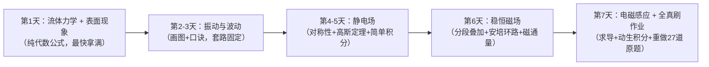

# 《大学物理》零基础期末复习重点与冲刺指南

> [!TIP]
> **给零基础同学的一颗定心丸**：从你的 6 次学习通作业来看，你们这门《大学物理》的考点非常集中、套路极强！全书主要覆盖 **6 个核心模块**，其中 **流体力学 + 液体表面现象 + 振动与波动** 几乎是纯套公式的“送分大户”，先拿下这三章就能稳住一半以上的基本盘，再去攻克 **静电场 → 稳恒磁场 → 电磁感应** 三大微积分计算模块。

---

## 一、零基础学习路线图（按投入产出比排序）

---

## 二、分章核心直觉 + 必背公式 + 作业高频题型

### 模块一：流体力学基础（第二章｜难度 ★☆☆☆☆）
**一句话人话理解**：管子越细流速越快（挤得快），流速越快压强越小（顾不上压管壁）。

| 核心公式 | 表达式 | 适用条件与考点 |
| :--- | :--- | :--- |
| **连续性方程** | $S_1 v_1 = S_2 v_2 = Q$ | 不可压缩理想流体定常流动；给截面积比求流速（作业 2-9） |
| **伯努利方程** | $p + \frac{1}{2}\rho v^2 + \rho g h = \text{常量}$ | 水平管直接消去 $\rho gh$；求最细处压强并判断开孔是否吸水（作业 2-9） |
| **托里拆利公式** | $v = \sqrt{2gh}$ | 侧壁/底部小孔出流速度，结合 $Q=Sv$ 求流量或容器最小深度（作业 2.8、2-10） |

---

### 模块二：液体的表面现象（第三章｜难度 ★★☆☆☆）
**一句话人话理解**：液体表面像绷紧的橡皮膜，总想缩小面积（表面能）；弯曲的液面永远向**凹**的那一侧多施压（附加压强）。

| 核心公式 | 表达式 | 避坑重点 |
| :--- | :--- | :--- |
| **表面能/做功** | $W = \Delta E = \alpha \Delta S$ | **肥皂泡有内外 2 个液面**（$\Delta S = 8\pi r^2$）；**水滴/气泡只有 1 个液面**（$\Delta S = 4\pi r^2$） |
| **球面附加压强** | 液滴/气泡：$\Delta p = \frac{2\alpha}{r}$ 肥皂泡：$\Delta p = \frac{4\alpha}{r}$ | 凹面一侧压强大于凸面一侧；双液面悬水柱题用 $p_A - p_B = \rho gh$ 联立（作业 3-10） |
| **毛细现象高度** | $h = \frac{2\alpha\cos\theta}{\rho g r}$ | 完全润湿 $\theta=0^\circ$（水，上升）；完全不润湿 $\theta=180^\circ$（水银，下降）；**注意题目给的是直径 $d$ 还是半径 $r$！** |

---

### 模块三：振动与波动（第四章｜难度 ★★★☆☆）
**一句话人话理解**：振动是“一个点原地上下晃”，波动是“前面那个点带着后面一排点依次延时晃”。

1. **简谐振动标准方程**：
   $$y = A\cos(\omega t + \varphi_0), \qquad \omega = \frac{2\pi}{T} = 2\pi\nu$$
   - **求初相 $\varphi_0$ 必杀技（旋转矢量法）**：
     - 看 $t=0$ 时的位移 $y_0 = A\cos\varphi_0$ 定左右；
     - 看 $t=0$ 时的速度方向：$v_0 > 0$（向上）选**下半圆**（$\varphi_0 \in (-\pi, 0)$），$v_0 < 0$（向下）选**上半圆**（$\varphi_0 \in (0, \pi)$）。
   - **同方向同频率合成**（作业 4-24）：
     $$A = \sqrt{A_1^2 + A_2^2 + 2A_1 A_2\cos(\varphi_1-\varphi_2)}, \qquad \tan\varphi = \frac{A_1\sin\varphi_1 + A_2\sin\varphi_2}{A_1\cos\varphi_1 + A_2\cos\varphi_2}$$

2. **平面简谐波（波函数）**：
   - **由振求波**（作业 4-26、4-28）：先写出原点 $O$ 的振动方程 $y_O(t) = A\cos(\omega t + \varphi_0)$，然后：
     - 沿 $+x$ 传播：把 $t$ 换成 $t - \frac{x}{u}$；
     - 沿 $-x$ 传播：把 $t$ 换成 $t + \frac{x}{u}$。
   - **由波形图判运动方向口诀**：波向**右**传时，**“上坡下、下坡上”**（顺着波传播方向看，爬坡的点向下动，下坡的点向上动）。
   - **波的干涉相消/加强**（作业 4-29）：同相波源相遇，波程差 $\Delta r = k\lambda$ 加强；$\Delta r = (2k+1)\frac{\lambda}{2}$ 相消（最小消音长度差 $\Delta l_{\min} = \frac{\lambda}{2}$）。

---

### 模块四：静电场（第五章｜难度 ★★★★☆）
**一句话人话理解**：有对称性（球/柱/无限大平板）闭眼用**高斯定理**；没高度对称性（有限长棒/圆环）老实切微元**积分**。

| 解题模型 | 核心公式 / 结论 | 对应作业题 |
| :--- | :--- | :--- |
| **有限长带电棒/圆环积分** | $dE = \frac{dq}{4\pi\varepsilon_0 r^2}$，利用对称性先消去抵消分量再积分 | 作业 5-12、5-13 |
| **高斯定理** | $\oint \mathbf{E}\cdot d\mathbf{S} = \frac{\sum q_{\text{内}}}{\varepsilon_0}$ | 作业 5-14（立方体通量）、5-15（同心球壳） |
| **无限大均匀带电平板** | $E = \frac{\sigma}{2\varepsilon_0}$（与距离无关，多块板直接矢量叠加） | 作业 5-17 |
| **电势叠加（标量！）** | $U = \int \frac{dq}{4\pi\varepsilon_0 r}$（圆环圆心 $U = \frac{\lambda}{2\varepsilon_0}$，不涉及方向！） | 作业 5-18 |

---

### 模块五：稳恒磁场（第六章｜难度 ★★★★☆）
**一句话人话理解**：磁场和静电场长得几乎一样，只是从“电荷产生 $E$”变成“电流产生 $B$”，方向全靠**右手螺旋定则**。

| 必背经典磁场结论 | 表达式 | 对应作业题 |
| :--- | :--- | :--- |
| **无限长直导线** | $B = \frac{\mu_0 I}{2\pi r}$（半无限长减半：$\frac{\mu_0 I}{4\pi r}$；延长线上 $B=0$） | 作业 6-14、6-16、6-21 |
| **圆弧电流圆心处** | $B = \frac{\theta}{2\pi}\cdot\frac{\mu_0 I}{2R}$（整圆 $\frac{\mu_0 I}{2R}$，四分之一圆 $\frac{\mu_0 I}{8R}$） | 作业 6-16 |
| **长直载流圆柱（安培环路定理）** | 柱内 $B = \frac{\mu_0 I r}{2\pi R^2}$；柱外 $B = \frac{\mu_0 I}{2\pi r}$；**表面 $r=R$ 处最大** | 作业 6-19 |
| **磁通量积分** | $\Phi = \int B(x)\,h(x)\,dx$（无限长导线旁共面矩形/三角形） | 作业 6-14 |
| **安培力与洛伦兹力** | $d\vec{F} = I\,d\vec{l}\times\vec{B}$（同向电流相吸、反向相斥）；霍尔效应 $\vec{F}=q\vec{v}\times\vec{B}$ | 作业 6-20、6-21 |

---

### 模块六：电磁感应定律（第七章｜难度 ★★★★☆）
**一句话人话理解**：**磁通量变了就有感生电动势**（先积分求 $\Phi(t)$ 再对 $t$ 求导）；**导体棒切磁感线就有动生电动势**（直接用公式或对 $\vec{v}\times\vec{B}$ 积分）。

| 核心题型 | 标准公式与解法 | 对应作业题 |
| :--- | :--- | :--- |
| **感生电动势** | 先写 $\Phi(t) = \int B(x,t)\,dS$，再套 $\mathcal{E} = -\frac{d\Phi}{dt}$，方向用楞次定律“增反减同” | 作业 7-17 |
| **旋转导体棒** | 绕端点转：$\mathcal{E} = \frac{1}{2}B\omega L^2$；绕棒上中间点转：两段电动势相减 $\frac{1}{2}B\omega(l_2^2 - l_1^2)$ | 作业 7-18 |
| **非均匀磁场中平动斜棒** | $\mathcal{E} = \int (\vec{v}\times\vec{B})\cdot d\vec{l}$，把 $dl$ 投影到垂直 $\vec{v}$ 的方向（$dr = dl\cos\alpha$）积分，方向沿 $\vec{v}\times\vec{B}$ 指向高电势端 | 作业 7-19 |

---

## 三、考场必背物理常数与避坑清单

> [!IMPORTANT]
> **必背常数（考卷有时不给！）**：
> - 水的密度 $\rho_{\text{水}} = 1.0\times 10^3\text{ kg/m}^3$，水银密度 $\rho_{\text{Hg}} = 13.6\times 10^3\text{ kg/m}^3$
> - 真空介电常数 $\varepsilon_0 = 8.85\times 10^{-12}\text{ C}^2/(\text{N}\cdot\text{m}^2)$，库仑常量 $k = \frac{1}{4\pi\varepsilon_0} = 9.0\times 10^9\text{ N}\cdot\text{m}^2/\text{C}^2$
> - 真空磁导率 $\mu_0 = 4\pi\times 10^{-7}\text{ T}\cdot\text{m/A}$（牢记 $\frac{\mu_0}{2\pi} = 2\times 10^{-7}$，$\frac{\mu_0}{4\pi} = 10^{-7}$）

> [!WARNING]
> **高频扣分坑点（含你作业中已暴露的 3 个失误）**：
> 1. **直径 $d$ 误当半径 $r$**：毛细管、肥皂泡、圆柱导体题极其爱给直径（如第六章第 3 题直径 $4\text{ cm}$ 半径应为 $0.02\text{ m}$，算错会差 2 倍）。
> 2. **合力方向只看符号不看物理直觉**：如第六章第 5 题，离直导线越近磁场越强，近侧斜边与直导线同向相吸，所以合力必然是**引力**而非斥力。
> 3. **指数与单位漏换算**：如第五章第 3 题 $ba^3$ 笔误写成 $ba^2$；$\text{cm}$、$\text{mm}$、$\text{km}^2$ 务必第一时间换算成国际单位 $\text{m}$、$\text{m}^2$。
> 4. **肥皂泡 vs 液滴**：见到“肥皂泡”第一时间标出 **2 个液面**（$W=8\pi\alpha r^2$，$\Delta p = 4\alpha/r$）。
> 5. **所有矢量题必须写方向**：求 $E$、$B$、$F$、$\mathcal{E}$ 的计算题，算完大小一定补一句方向，否则必扣步骤分！
